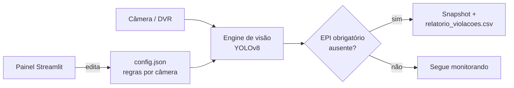

# 🛡️ SafeGuard IA — Monitoramento Inteligente de EPIs

O **SafeGuard IA** é uma solução de Visão Computacional desenvolvida para as exigências da **Indústria 4.0**. Utilizando a arquitetura **YOLOv8**, o sistema automatiza a fiscalização de Equipamentos de Proteção Individual (EPIs), garantindo segurança em tempo real com gestão flexível, remota e integrada.

## Projeto Campeão da I-Tech 2026: Feira de Ciências do SENAI-SP Cruzeiro

---

## 🧠 Como funciona



---

## 🚀 Funcionalidades Principais

| Recurso | Descrição |
|---|---|
| 🔍 **Detecção Multiobjeto** | Identificação simultânea de Capacete, Óculos, Luvas, Botas, Protetor Auricular, Máscara e Colete |
| ⚙️ **Gestão Dinâmica** | Painel administrativo (Streamlit) para ativar/desativar regras por câmera via JSON em tempo real |
| 🌐 **Acesso Remoto IoT** | Dashboard acessível via 4G/5G com tunelamento seguro Ngrok e QR Code automático |
| 📸 **Snapshot de Violação** | Captura automática com lógica de cooldown ao detectar infrações |
| 🖥️ **Tela Cheia** | Monitor de câmera em fullscreen; pressione `F` para alternar a qualquer momento |
| ⚡ **Automação Total** | Launcher único que sobe o painel web e a engine de IA simultaneamente |

---

## 📂 Estrutura do Repositório

```
SAFEGUARDIA/
├── config/                  # Configurações JSON (regras por câmera)
│   └── config.json
├── dataset/                 # Banco de imagens
│   ├── raw/                 # Imagens brutas para treinamento
│   └── processed/           # Imagens redimensionadas (640x640)
├── models/                  # Pesos da IA
│   └── best.pt
├── src/                     # Scripts principais
│   ├── app.py               # Painel de Controle (Streamlit)
│   ├── automacaototal.py    # Engine de Visão + Túnel Ngrok
│   ├── launcher.py          # Orquestrador do Ecossistema
│   └── utils.py             # Pré-processamento de dataset
├── capturas_violacao/       # Evidências visuais de infrações (gerado em runtime)
├── relatorio_violacoes.csv  # Log de eventos (gerado em runtime)
├── requirements.txt         # Dependências do projeto
└── README.md
```

---

## 🛠️ Guia do Desenvolvedor

### 1. Preparação do Ambiente

```bash
# Clone o repositório
git clone https://github.com/SergioJr06/SafeGuardIA.git
cd SafeGuardIA

# Crie e ative o ambiente virtual
python -m venv venv
source venv/bin/activate    # Linux/Mac
.\venv\Scripts\activate     # Windows

# Instale as dependências
pip install -r requirements.txt
```

### 2. Configuração do Ngrok

Configure seu token de autenticação (necessário apenas uma vez):

```bash
ngrok config add-authtoken SEU_TOKEN_AQUI
```

> ⚠️ **Nunca exponha seu token no código ou no repositório.** Utilize variáveis de ambiente ou o comando acima.

### 3. Configuração das Câmeras

Edite `config/config.json` para definir as fontes de vídeo e os EPIs obrigatórios por câmera:

```json
{
    "cameras": {
        "cam_0": {
            "nome": "Webcam Local",
            "source": 0,
            "require_helmet": true,
            "require_glasses": false
        }
    }
}
```

### 4. Como Rodar

```bash
python src/launcher.py
```

---

## 📖 Manual do Usuário

1. **Acesso Remoto** — Escaneie o QR Code gerado no terminal para acessar o Dashboard pelo celular.
2. **Configuração** — No painel, selecione a câmera e marque os EPIs obrigatórios. Clique em **Salvar**.
3. **Monitoramento** — A IA aplica as regras em tempo real (recarregamento a cada ~30 frames). Snapshots são salvos automaticamente em `capturas_violacao/`.
4. **Teclado (janela da câmera)**:
   - `1` / `2` / `3` — Alternar entre câmeras
   - `F` — Alternar tela cheia / janela
   - `Q` — Encerrar

---

## ⚡ Dicas de Performance (DVR Intelbras MHDX)

- Use sempre o **sub-stream** (`subtype=1`) na URL RTSP para menor latência.
- O script já configura `fflags=nobuffer` e `flags=low_delay` no FFmpeg automaticamente.
- Em redes Wi-Fi com instabilidade, prefira conexão cabeada ao DVR.
- Sem GPU, reduza `imgsz` para `480` em `automacaototal.py` para ganhar FPS.

---

## 🛡️ Segurança e Boas Práticas

- O `.gitignore` garante que `venv/`, credenciais e capturas não sejam enviados ao repositório.
- **Nunca commite** tokens do Ngrok ou senhas de câmeras no código-fonte.
- Em produção, armazene credenciais em variáveis de ambiente (`.env` + `python-dotenv`).